> **TL;DR**
> 人类研究者依靠 research taste，在不做实验的情况下就能判断一个 idea 是否值得投入。我们尝试为 ideation 系统的评估拟合这种能力：构建一个对两份 proposal 做 pairwise 比较的 judge agent，并以研究社区后续的反馈（引用）作为校准信号。在由真实论文还原的 proposal pair 上，judge agent 与后续引用排序的一致率达到 **75–83%**。但只看两份 proposal 的标题，其准确率依然有 **约 73%**；在 75 对人工标注的 human–AI pair 上，准确率只有 **49.3%**，接近随机；从现有证据看，judge agent 判断的主要是选题热度、可引用性和包装完整度，而不是一个 idea 在领域已有知识下是否 sound、是否可行。


https://github.com/02hyc/IdeaEval
https://huggingface.co/datasets/Yukino13/IdeaEval-Bench
https://huggingface.co/datasets/Yukino13/IdeaEval-Calibration
https://huggingface.co/datasets/Yukino13/IdeaEval-Corpus


自今年三月起，我们在 research idea 评估这个议题上做了很多的尝试和探索。本篇整理出这个过程中的一些思考，为这个周期的努力留有一些公开的痕迹和微末的启发。

## The last step to high-quality auto research
在 2026 年 11 月份的当下，auto research 已然泛滥。截至 9 月，ICLR 2027 的 abstract 注册数突破了 6 万篇 [1]，而一年前的有效投稿还不到 2 万，十年前，这个数字是 490。顶会投稿数量水涨船高，审稿本身也被 AI 渗透，质量良莠不齐。

必须承认的是，agent 已具备将一份 proposal 转换成代码，并进行完整实验的能力。我们在年初开发了端到端 auto research 系统 FARS [2]，并在春节期间全程直播自动化科研过程，成功产出大量具有真实代码和运行记录的 paper。但绝大部分产出都流于平庸，这源于 agent 所执行的 proposal 本身质量不足。大部分 agent 产出的 proposal 都比较 trivial, 只是多个组件的简单拼接，不乏很多几乎不可行的。

我们认为 proposal 的质量是 auto research 的关键瓶颈，如果 ideation 系统能够自主提出有价值、有创新性的 proposal，就能打通高质量 auto research 的最后一步。因此，我们开始重点关注 agent 的 ideation 能力。

## Ways to evaluate a research idea
问题就在于 ideation 系统所产出的 proposal 质量如何衡量。一般而言，一份 proposal 最好的评估，就是将其付诸实验并由结果来判定。AlphaEvolve [3] 用 LLM 驱动程序的进化搜索，每个候选程序都由一个自动的 evaluator 打分，并迭代反馈；Anthropic 的 Automated Alignment Researcher [4] 研究 weak-to-strong supervision，一次微调实验不到两小时，agent 把预测结果提交给远程 API 就能直接拿到 PGR（performance gap recovered）分数；这类任务的共同点是 outcome-gradable：问题被事先定义好，有一个明确、可自动计算的指标，反馈周期以分钟或小时计，系统可以大量试错，直接朝着指标 hill-climb。

但我们关注的 auto research 是更通用的场景，面对的是开放的研究问题，若把 proposal 付诸实验，从写代码、跑实验到分析结果和迭代，完成周期也通常以周甚至月为单位，这种时间成本是 ideation 过程无法承受的，且一旦一个极不可靠的 proposal 直接进入实验阶段，也会浪费大量实验资源。因此需要考虑别的方式。

在一般的科研过程中，人类研究者依赖其在研究生涯中积累的 research taste 来对一个 idea 进行事前的评估，他们往往能够凭借过往的研究经验，并结合研究领域的现状，在不经过完整实验的情况下判断一个 idea 是否可靠且具有价值，并以此决定是否投入后续的探索。这很符合我们所期望的 ideation 系统的评估方式。若 ideation 的评估系统也能够具有这种 research taste，就能够在 ideation 阶段对 proposal 给出直接的评估和反馈，从而将那些不值得后续投入的 proposal 直接筛去。

因此我们需要去拟合出这种 research taste，并以此作为 ideation 系统的评估标准。如何去量化这种 research taste 呢？领域中已有不少工作直接对 idea 的评估进行建模和评测，它们虽然大多并未以 research taste 为目标，但都选取了某种信号作为评判 idea 好坏的 ground truth，可以看作是对 research taste 的不同近似。然而这些信号都存在一定的局限性。

![Evaluation signals on an idea's timeline. When the idea is proposed, before any experiment: expert ratings [9][10] and novelty checks [14]. After experiments: experimental outcomes [15] and hypothesis verification [16][17]. At publication: matching the published paper [5–8] and acceptance or reviews [11–13]. Months to years later: citations and awards [18][19]. Earlier signals are noisy or partial; complete signals arrive only after the fact. Research taste means predicting, at the moment an idea is proposed, what the community will say later](../ideaeval/figures/16-signal-timeline.svg)

### Published papers as ground truth

这类工作把 research taste 近似为“能否想到已被发表的那个 idea”，但它衡量的其实是复现 target paper 的能力，而非判断 idea 好坏的能力。具体做法是把 target paper 发表前可获得的 context 交给模型，看生成的 idea 与原论文有多接近：IdeaBench [5] 以 2,374 篇生物医学论文所引用的参考文献摘要为输入，用语义相似度和 LLM 打分衡量重合度；AI Idea Bench 2025 [6] 在 3,495 篇 AI 顶会论文上以 motivation 和实验计划为 ground truth；ResearchBench [7]（及其前身 MOOSE-Chem [8]）则把科学发现拆为 inspiration 检索、假设组合与假设排序三步。这类 ground truth 可靠且易于规模化，但同一问题下值得做的 idea 远不止被发表的那一个，一个思路不同但同样有价值的 proposal 会被直接判错。

### Expert judgment as ground truth

这是对 research taste 最直接的近似：让具有 taste 的人来判断。但专家的 taste 本身噪声大，也难以规模化。Si 等人 [9] 组织 100 多位 NLP 研究者盲评人类与 LLM 写的 idea，评审间的一致性仅有 56.1%，低于 NeurIPS、ICLR 正式审稿的水平；Anthropic 的 **TASTE** [10] 请 10 位 AI safety 研究者对 Claude Opus 4.6 生成的 proposal 打分、讨论并修正，最终只保留了 92 对偏好明确的 pair（该工作与我们的思路相近，但在我们的工作周期内尚未发表）。**GraphEval** [11]、**InnoEval** [12]、**ScholarEval** [13] 退而以 ICLR、NeurIPS 等会议的录用结果或审稿意见为标签，获取成本更低，但录用结果混杂了写作质量、实验完成度、审稿人匹配、投稿时机等因素，与 idea 本身的价值仍有不小的 gap。

### A single verifiable dimension as ground truth

这类工作把 research taste 拆解为某个可以客观检验的侧面，结果可靠，但 taste 恰恰体现在对多个维度的综合权衡上。Literature-Grounded Novelty Assessment [14] 只评 novelty，检索相关文献后按 purpose、mechanism、evaluation 等 facet 逐一比对；Forecasting Research Success [15] 只评实验结果，在一万多对 idea 上预测哪个能在同一 benchmark 上表现更好；TruthHypo [16] 和 HypoBench [17] 只评假设的真实性与解释力，分别以后续文献和合成数据的真实生成机制为参照。然而一个 novel 的 idea 可能毫无意义，一个能在 benchmark 上提点的 idea 也可能只是又一个工程 trick，这正是 FARS 产出的典型问题；并且它们评的多是单个假设或方法，而非一份完整的 proposal。

### Later community feedback as ground truth

这类工作把 research taste 近似为对 idea 长期影响力的预判，这是与 idea 真实价值最接近的信号。**Proof of Time** [18] 给 agent 某个时间点之前的证据快照，让它预测之后的论文引用与奖项、研究者的方向变化或 benchmark 的性能区间；**AI Can Learn Scientific Taste** [19] 直接把 scientific taste 定义为判断和提出高影响力 idea 的能力，从 210 万篇 arXiv 论文中构造约 72 万对同领域、同时期的论文，以引用高低为标签训练 Scientific Judge，再以其为 reward model 训练提出 follow-up idea 的 Scientific Thinker。

但现有工作评估的是论文的 title 和 abstract，其中往往已经包含实验结果与结论，本质上是事后判断，而 research taste 的关键恰恰在于事前。不过这类工作给了我们一个重要启发：人类研究者的 taste 正是在反复观察 idea 后续被社区采纳或遗忘的过程中积累起来的。因此，若能将 ideation 阶段对 proposal 的事前评估与其后续的社区反馈对齐，就是在拟合这种 research taste。这正是这项工作的出发点。

## Judging an idea against its time
要把对 idea 的事前评估 (research taste) 与事后反馈 (community feedback) 对齐，我们先梳理一个 idea 从提出到产生价值的过程。

一个 idea 总是针对某个 research question、在某个时间点提出的。它的价值一方面取决于提出时领域已有的知识，另一方面取决于它被做出来之后对后续工作的影响；同样的 idea 在不同时间点提出，价值可能截然不同。我们记 t 时刻领域的 knowledge base 为 $K_t$，记 proposal 的核心 hypothesis 为 $H$，将 idea 的价值定义为在 $K_t$ 下推进 $H$ 能为未来 knowledge base 带来的期望增量：

$$V(H, K_t) = \mathbb{E}[\Delta K \mid H, K_t]$$

在这个定义下，research taste 就是在 $H$ 被执行之前估计 $V(H, K_t)$ 的能力。$V$ 有三个性质：
1. 它是一个预测。 $V$ 的真实取值要等 idea 被执行、被社区接纳后才能显现，评估系统只能在 $K_t$ 下给出预期。
2. 它需要用社区反馈来校准。 历史上哪些 idea 后来被采用、被继承、被反复比较，就是 $V$ 的后续观测值。
3. 它适合做相对比较。 一个 idea 的绝对价值没有可靠的客观标签，也难以直接校准；在同一 research question、同一 $K_t$ 下比较两份 proposal 要简单得多。这也契合 ideation 系统的工作方式：在同一 $K_t$ 下反复进行 “生成—评估—修缮” 的比较与迭代，理论上就能逐渐逼近更好的 idea。

历史是一个迟到的评估者：一个 idea 的价值，往往要很久之后才由社区给出答案。我们的思路是借助这些已经沉淀的社区反馈来拟合事前的评估：把历史 paper 还原成实验前的 proposal，以它们后来获得的社区反馈为标签，构造一个 idea 评估的 benchmark。它一方面用于校准评估系统本身，另一方面用于评估 ideation 系统产出的 proposal。构造这个 benchmark 需要回答三个问题：评估应当采用什么形式？如何找到共享同一 $K_t$ 的 proposal？用什么社区信号作为标签？

## Turning history into a ruler
### Compare proposals only against their contemporaries
由于 $V(H, K_t)$ 适合做相对比较，且比较必须在相同的 $K_t$ 下进行，评估的基本单位就是同一 $K_t$ 下的一对 proposal。我们近似地认为研究同一个 research question、在同一个短时间窗口内发表的 paper，共享相同的 $K_t$，由它们还原出的 proposal 也彼此可比。ideation 系统若在窗口起点 $t$ 针对同一 research question 产出 proposal，它能利用的同样只有 $K_t$，因此也可以与这些人类 proposal 直接比较。

在这一形式下，评估系统就是一个 pairwise ranker，一方面在两份人类 proposal 之间做判断，再用它们后来的社区反馈检验判断是否正确，这是校准（calibration）；校准可信之后，再把 AI proposal 与同一窗口内的每一份人类 proposal 逐一比较，以胜率衡量 ideation 系统的能力，这是评测（ideation）。因此，benchmark 构造的目标，就是找出足够多共享同一 $K_t$ 的 paper。

### Carving the literature into cohorts
共享同一个 $K_t$ 需要两个条件：研究同一个 research question，且在同一段时间内发表。一个自然的思路是先按 research question 对文献聚类，再在每个类内按时间切分窗口。

**数据选择** 历史 paper 必须晚于评估系统 base model 的 knowledge cutoff，否则模型可能在训练中见过它们。我们计划使用的 GPT-5.4 和 Opus 4.6，cutoff 均在 2025 年 8 月 [20][21]，因此选用 arXiv 上 2025 年 9 月至 2026 年 1 月的 AI 论文（cs.LG、cs.AI、cs.CL、cs.CV、stat.ML）。剔除 survey、纯 benchmark、纯数据集等不以研究假设为核心的 paper 后，共 35,505 篇。

**聚类** 我们按研究问题本身的语义做树状聚类，并用 cluster 的大小、而非语义规则来界定 research question 的粒度。这两点都来自最初方案的教训。最初我们给每篇 paper 抽取 topic、method family、used benchmark 等标签，按标签重叠度聚类，但标签重合并不等于研究同一个问题：SimpleTIR [22] 和 Inpainting-Guided Policy Optimization for Diffusion LLMs [23] 的标签几乎一致（RL、推理、数学 benchmark），一篇研究的却是工具调用的多轮 RL，另一篇是扩散语言模型的策略优化。同时，得到的 cluster 粒度悬殊且彼此存在重叠，而这种 research question 粒度很难用自然语言规则来约束。

具体实现上，我们参考 TaxoAdapt [24]，以 title、research problem、task formulation 和 used benchmark 为特征逐层聚类，一直细分到每个叶子节点包含 10 到 50 篇 paper，每个叶子即一个 research question。一、二级节点经过人工去重，每篇 paper 可属于 1 到 3 个节点。最终得到一棵 6 层、1,799 个叶子节点的树；为每个叶子归纳 research question 并逐篇核查后，剔除了 4,357 篇不相关的 paper。

**按时间切分窗口** 我们在每个 topic 内以 31 天为窗口切出 cohort：同一个 research question、同一个月内发表的一组论文，即对 "同一个 $K_t$" 的近似。这里的 topic 是子树总论文数不超过 150 的节点，而不是叶子节点，因为叶子节点论文太少，再按时间切开就没有足够的 paper 数量了。此外有些 paper 在上 arXiv 之前，已经以期刊或 OpenReview 投稿的形式公开。我们对全部论文做了 date leak 检查，修正了真实公开日期，并剔除了有问题的论文。

### Rewinding papers into proposals
找到 cohort 之后，还需要将其中 paper 还原成实验前的 proposal。还原遵循两条原则：不泄漏结果，并忠实于 paper 本身的研究计划。我们把 paper 的内容分为研究计划、先验知识和实验结果三类：结果全部移除，主结果表中提出方法的数字替换为 TBD，paper 的结论改写为待验证的假设；而与哪些 baseline 比较、做哪些消融、在哪些数据集上评测，则属于研究计划而完整保留。

还原后的 proposal 统一为七节的固定结构：Introduction（核心洞见、可证伪的假设和潜在的失败模式）、Proposed Approach、Related Work、Experiments、Success Criteria、Impact Statement 和 References。ideation baseline 也按同一结构产出 proposal，两者因而可以直接比较，评估系统不会因为格式差异而偏向某一方。

### Four-month citations predict the twelve-month ranking
我们以同一 cohort 内 paper 的引用高低作为 which one is better 的标签。难点在于，这批 paper 在我们拉取数据时只发表了 4 到 8 个月。回测表明，只要两篇 paper 的引用差距足够大，早期的引用排序就已经与 12 个月后的排序高度一致。

**社区信号的选择** 我们真正想衡量的是 idea 为领域 knowledge base 带来的增量，它无法直接观测，只能借助间接信号。会议评审分数是一个选项，但审稿质量参差、审稿人标准不一，公开数据也少。引用同样有噪声，会受机构和作者声誉的影响，但在同一 research question、同一时期内比较长期引用（发表后 12 到 18 个月）时，领域热度、发表时机等主要混淆因素会被抵消相当一部分；剩下的差异更多反映的是谁的方法被采用、谁的问题定义被继承、谁的结果被反复拿来比较，这更接近 idea 本身的价值。

**长期引用难以获取** 为避免数据污染，我们只能使用 2025 年 9 月之后的论文，而到 2026 年 5 月拉取引用时，它们只发表了 4 到 8 个月。等一年再评测并不现实，届时新模型的 knowledge cutoff 又会覆盖这批 paper：标签的可信需要时间，评测的有效却要求 paper 足够新。我们也尝试过按引用上下文给早期引用量加权来拟合长期引用的效果（例如 Background 0.5、Comparison 1、Use 和 Extension 1.5），但 Semantic Scholar API [25] 提供的引用上下文缺失较多，修正效果不佳，最终放弃。

**在历史数据上进行回测** 我们转而直接检验：早期的原始引用排序，是否在一定条件下能够和长期引用具有一致性？我们取 2024 年 1 至 5 月的 29,135 篇 AI 方向 arXiv paper，用与 benchmark 相同的方式聚类并按月切出 cohort，在 cohort 内两两配对，比较发表后 4 到 8 个月时的引用排序与 12 个月后的排序是否一致。结论是，当两篇 paper 的引用数 $c_a$、$c_b$ 同时满足以下两个条件时，早期排序已足够可信：

$$|c_a - c_b| \ge 4 \quad \text{且} \quad |\log(1+c_a) - \log(1+c_b)| \ge 0.5$$

绝对差距保证差异不是一两次偶然引用造成的，对数差距保证差异相对于基数足够大，两者缺一不可：只看对数差距，会放进 0 对 1、1 对 3 这样只差一两次引用的 pair；只看绝对差距，又会放进 40 对 44 这样相对差距很小的 pair。以 4 个月的窗口为例，同时满足两个条件时一致率最高，覆盖率与只看绝对差距几乎相同：

| Filtering rule | Coverage | Agreement with 12-month ranking | Ranking flip rate |
|---|---|---|---|
| Absolute gap only, $d \ge 4$ | 37.9% | 96.9% | 2.5% |
| Log gap only, $\text{log\_gap} \ge 0.5$ | 63.2% | 93.1% | 5.4% |
| Both | 37.2% | 97.3% | 2.1% |

随着观察窗口延长，一致率从 97.3% 升至 99.4%，覆盖的 pair 也从 37.2% 增加到 49.9%：

| Observation window | Pairs selected | Coverage | Agreement with 12-month ranking | Ranking flip rate |
|---|---|---|---|---|
| 4 months | 2,910 | 37.2% | 97.3% | 2.1% |
| 5 months | 4,439 | 42.3% | 97.8% | 1.6% |
| 6 months | 5,897 | 45.7% | 98.3% | 1.2% |
| 7 months | 7,248 | 47.9% | 99.0% | 0.7% |
| 8 months | 8,667 | 49.9% | 99.4% | 0.3% |

因此，在同一个 cohort 内，满足这两个条件的 paper 对，可以用引用高低作为 which one is better 的标签。

### Two benchmarks from the same cohorts
上述 cohort 和引用规则最终构成两个 benchmark，分别用于 pairwise ranker 的两种用途：calibration benchmark 是带引用标签的人类 proposal pair，检验 ranker 本身的可靠性；ideation benchmark 是一组 cohort，衡量 AI proposal 能胜过多少同期的人类 proposal。

|  | Calibration benchmark | Ideation benchmark |
|---|---|---|
| Purpose | Calibrate the ranker | Evaluate ideation systems |
| Unit | Paper pairs from the same topic, published ≤ 31 days apart | A 31-day cohort within a topic |
| Label | Order given by the citation rule | None needed; the ranker compares one by one |
| Size | 260 pairs covering 37 topics | 91 cohorts covering 40 topics |

**Calibration benchmark** 由同一 topic 内、发表时间相差不超过 31 天的 paper 两两配对构成，只保留满足上一节引用规则的 pair，引用较高的一方即为胜者。为了让校准结论能迁移到 ideation 评测，我们让它的 topic 分布尽量贴近 ideation benchmark：最初版本共 260 对，覆盖 ideation benchmark 40 个 topic 中的 37 个（下一章会说明我们为何又对它做了调整）。

**Ideation benchmark** 从聚类树中人工挑选的 70 个热门 topic 出发，按 31 天切出 cohort。为保证人类 proposal 的质量，剔除了零引用的 paper；为保证每个 cohort 有足够多的比较对象，只保留至少 10 篇 paper 的 cohort。最终剩下 91 个 cohort，覆盖 40 个 topic。每个 cohort 的 cutoff $t$ 取其中最早一篇 paper 公开日期的前一天。评测时，ideation 系统拿到 cohort 的研究方向和 $t$，生成一份 proposal，由 ranker 与 cohort 内的每一份人类 proposal 逐一比较，胜率即为该系统的得分。

## The judge was grading topics, not ideas
有了 benchmark 和引用标签，下一步是构造 judge 并在历史数据上校准它。第一轮校准的结果看似不错，但随着探索的深入，结果愈发扑朔。

### A three-stage ranker with a non-compensatory rubric
如前所述，idea 评估系统是一个 pairwise ranker：给定两份 proposal 和 cutoff 日期 $t$，判断在相同的 $K_t$ 下哪一份的 $V(H, K_t)$ 更大。我们以 GPT-5.4 和 Opus 4.6 为 base model，把评估拆成三个阶段：
1. **Literature Review Agent**：在 cutoff 之前的文献中，对两份 proposal 共同的研究方向做一次全面调研，产出一份可复用的 literature review，作为 $K_t$ 的显式表示；
2. **Parallel Analysis Agent**：在 literature review 的基础上，分别针对两份 proposal 做增量检索，产出两份 analysis report，分析各自在 $K_t$ 下的增量价值；
3. **Judge Agent**：阅读 literature review 和两份 analysis report，依据 rubric 给出最终判断。

rubric 是我们校准 judge 的主要提示手段。它把 $V(H, K_t)$ 拆成七个因子，要求 judge 在每个因子上对两份 proposal 两两比较，再综合给出 A ≻ B 或 A ≺ B。由于 $V$ 是期望增量，这些因子既覆盖 idea 成功后的价值，也覆盖其被做出来的概率：

1. **Demand**：研究社区是否关注这个问题；
2. **Marginal Contribution**：相对于已被社区吸收的工作，增量贡献有多少；
3. **Realization Probability**：核心主张有多大可能被真正做出来；
4. **Informative-Negative Value**：即便假设不成立，失败的结果是否仍有启发意义；
5. **Adoptability**：如果成功，后续工作能否使用或扩展它；
6. **Experimental Credibility**：实验设计能否产生让社区信服的证据；
7. **Cost or Risk**：所需资源和承担的风险是否可控。

这七个因子不能互相补偿，这是一个 idea 产生价值必须依次通过的环节：任何一环接近零，$\Delta K$ 就接近零。重复已有工作则增量价值为零，不可靠的假设前提则实验结果无法实现，薄弱的实验设计则无法给出可信证据；一个维度的高分，无法补偿另一个维度的致命缺陷。

### The first calibration looked like a success
在最初的 calibration benchmark 上，ranker 与引用排序的一致率约为 75%，明显高于随机和 "总是预测 A ≺ B" 的 baseline。我们从 260 对 pair 中切出 60 对作为 dev set，其余 200 对作为 test set（test 上为三次运行）：

| Setting | Data | Accuracy |
|---|---|---|
| Random | dev | 50.0% |
| Always predict A < B | dev | 55.0% |
| Ranker (GPT-5.4) | dev | 78.3% |
| Ranker (GPT-5.4) | test | 76.0% / 75.5% / 74.5% |

按两篇 paper 的 citation gap 分桶，gap 在 50 以上的 15 对全部判对，与预期一致：引用差距越大，两份 proposal 的质量差异也越明显。不过 gap 在 50 以下时，准确率并没有随 gap 增大而单调上升：

| Citation gap | 0–10 | 11–19 | 20–49 | 50+ |
|---|---|---|---|---|
| Pairs | 42 | 77 | 66 | 15 |
| Accuracy | 76.2% | 67.5% | 78.8% | 100% |

### Removing the literature review, or even the core idea, didn't hurt
进一步拆解发现，这 75% 的一致结果既不依赖我们设计的三阶段结构，也不依赖 proposal 中承载 idea 的核心内容。

**去掉 literature review 和 analysis，准确率依旧** 只保留 Judge Agent 直接读两份 proposal，准确率与完整的三阶段 ranker 持平，GPT-5.4 和 Opus 4.6 结果一致：

| Configuration | Accuracy |
|---|---|
| Three-stage ranker + GPT-5.4 | 75.5% |
| Judge Agent only + GPT-5.4 | 76.0% |
| Judge Agent only + Opus 4.6 | 76.0% |

按我们的设计，没有一份统一、可信的 literature review，judge 无从判断 proposal 在 $K_t$ 下的增量，准确率理应下降。

**校准集时间分布更均衡后，准确率愈高** 我们先怀疑 benchmark 本身：260 对 pair 大多集中在 2025 年 9 月，紧贴两个 base model 8 月的 knowledge cutoff，模型可能本就熟悉相关领域。于是我们按同一筛选规则重新选取 pair，构建了一个时间分布更均衡的 250 对 test set，准确率却升到了 80% 以上。

**删掉 proposal 的核心假设和方法，准确率依然保持** 我们怀疑，由真实 paper 还原的 proposal 本身就带有某种与 idea 无关的质量信号。对 proposal 的各章节做消融后，两个模型在各种输入组合下的准确率都在 79–83% 左右，删掉核心假设和方法后甚至略高：

| Input | GPT-5.4 | Opus 4.6 |
|---|---|---|
| Random | 50.8% | 50.8% |
| Core hypothesis + method + experiments | 79.2% | 82.0% |
| Core hypothesis + method | 78.8% | 79.6% |
| Full proposal | 82.4% | 80.4% |
| Full proposal minus core hypothesis and method | 83.2% | 80.8% |

我们认为部分原因在于 proposal 章节之间的信息冗余：删掉核心假设后，它仍会在 Introduction 和实验设计中间接出现。我们还猜测，一份高质量的 proposal 本身就写进了足够多的领域知识，这可能也是 literature review 没有带来额外增益的原因。

### Titles alone are enough for 73%
最极端的消融是只给 judge 两份 proposal 的标题，准确率仍有约 73%（GPT-5.4 为 72.8%，Opus 4.6 为 74.0%）。核查推理过程发现，judge 确实在围绕问题域和方法的可传播性做判断。例如 *Monet: Reasoning in Latent Visual Space Beyond Image and Language* [26] 和 *CoCoVa: Chain of Continuous Vision-Language Thought for Latent Space Reasoning* [27]，judge 仅凭两个标题就认为后者 "names a more concrete and citeable research object"，并且判对了。

| Input | GPT-5.4 | Opus 4.6 |
|---|---|---|
| Random | 50.8% | 50.8% |
| Titles only | 72.8% | 74.0% |

我们认为基于之前的 rubric， judge 在这个 benchmark 上判断的主要是选题和传播性：方向是否热门，贡献好不好被引用，名字起得响不响。一个只看标题的 judge 就能解决 calibration benchmark 的大半，说明这个 benchmark 测到的能力，与我们真正想测的 idea 评估能力之间存在明显差距。

### The judge falls for ambitious proposals
差距在哪儿呢？这个问题在评测 AI proposal 时被放大了：judge 偏爱看上去宏大、易被采用的 proposal，却不检查它是否成立。

我们同时搭建了一批 ideation baseline：给定一个 cohort 的研究方向和 cutoff 日期，让 Claude Code 和 Codex 等 CLI agent 借助一组有严格 cutoff 限制的文献检索工具，完成文献调研、gap 分析、假设提出和实验设计，最后产出一份 proposal。我们用五个模型在 ideation benchmark 的 91 个 cohort 上各产出了 proposal，再由基于 Opus 4.6 的 judge 把每份 AI proposal 与同一 cohort 中的人类 proposal 逐一比较。胜率普遍很高，但排序与这些 agent 的实际能力并不一致：

| Ideation system | Win rate vs. human proposals |
|---|---|
| GLM-5.1 + Claude Code | 78.8% |
| Opus 4.6 + Claude Code | 75.5% |
| DeepSeek-V4-Pro + Claude Code | 69.4% |
| GPT-5.4 + Codex | 54.6% |
| Kimi-K2.6 + Claude Code | 50.7% |

以 DeepSeek-V4-Pro 为例。它在一个多轮 agent 强化学习的 cohort 上，提出了一个解决多轮交互中信用分配问题的方法，与 cohort 中 13 份人类 proposal 逐一比较，全部胜出。judge 给出的理由是：它解决的是一个 "fundamental algorithmic problem"，是一个 "drop-in module"，"no auxiliary model"，可以被 GRPO/DAPO 的大量用户直接采用，因而会获得 "durable method citation"。但它的核心机制并不成立：它把同一 step index 下不同 rollout 的动作当作彼此的 counterfactual，以此估计每一步的 advantage；而在多轮交互中走到第 k 步时，不同 rollout 的 observation history 早已分叉，这些动作并非同一状态下的不同选择，也就构不成 counterfactual。



judge 会被这类 proposal 打动，是因为它没有认真验证可行性。而 calibration benchmark 暴露不了这个弱点：其中的 proposal 全部改写自真实 paper，可行性在构造时就已得到保证。这是 calibration 与真实评测之间的分布偏差。

### The judge is at chance for human-AI pair
为弥补这一偏差，我们构造了 human–AI pair 来重新校准 judge，结果它的准确率只有 49.3%，接近随机，并且系统性地偏向 AI proposal。

**标注过程** human–AI pair 没有引用可以作为标签，只能人工标注。我们逐份检查 ideation baseline 产出的 AI proposal：是否已被已有工作抢先、是否存在幻觉、方法是否 sound、实验设计是否有缺陷，并标注严重程度、附上证据；再将它与对应 cohort 中的人类 proposal 组成 pair。少数质量确实较高的 AI proposal 也如实参与比较。最终得到 75 对 pair：AI 胜出 18 对，人类胜出 57 对，后者中的 AI proposal 大多标有显著缺陷。

**实验结果** 我们修改了 judge，使其与标注流程一致：先识别 proposal 的缺陷并判断严重程度，再做综合判断。它在 AI 胜出的 pair 上准确率为 83%，在人类胜出的 pair 上只有 39%：

| Label | Pairs | Accuracy |
|---|---|---|
| AI proposal better | 18 | 83% |
| Human proposal better | 57 | 39% |
| Overall | 75 | 49.3% |

**缺陷识别分析** 在所有判错的 pair 中，judge 没有一次把 AI proposal 判为存在致命缺陷；在标注者认定 AI proposal 存在致命缺陷的 15 对中，它只识别出 8 对。具体 case 中，judge 往往读到了缺陷所在的位置，却没有验证；有时它已经识别出标注者指出的风险，最终仍判 AI 胜出。它更偏好 AI proposal 中完整、漂亮的实验计划，还会主动把 AI proposal 中站不住的宽泛假设收窄成一个仍然可行的版本，却不给人类 proposal 同样的宽容。

### Nothing we tried helped
此后的所有修正，准确率都没有超过最初的 49.3%：
- **重排 rubric**：先审核 proposal 的核心主张，再判断 soundness 和可行性，再检查已有工作，最后才评估影响力。
- **强制验证**：要求 judge 对 proposal 中每一个公式和关键信号动手验证，必要时写代码跑一个最小例子。这在行为上确实生效了，judge 开始做维度检查、逐行验证推导，也能识别出部分标注的缺陷，但准确率没有起色。
- **更换 base model**：包括能力更强但 knowledge cutoff 并不满足要求的 GPT-5.5。

| Judge Agent | Overall accuracy | AI-better subset | Human-better subset |
|---|---|---|---|
| GPT-5.4 (original rubric) | 49.3% | 83% | 39% |
| GPT-5.4 (restructured rubric) | 45% | 89% | 32% |
| Opus 4.6 (forced verification) | ~43% | 100% | 32% |
| GPT-5.5 (forced verification) | 45% | 67% | 39% |

我们猜测，ideation 系统把 AI proposal 包装得新颖、宏大、高影响，而人类 proposal 忠实描述的是一篇真实的、因而往往是增量的、扎堆的、工程化的 paper；judge 的任务恰恰是预测影响力、新颖性和被引用的可能性，在这些维度上 AI proposal 天然占优。有很多因素需要进一步分析，但项目至此，恰逢一些外部因素，探索过程也到此为止了。

## Afterword
我们最终没能把 judge agent 校准到可用的程度。项目 paper 几乎已经写好，只差填入对 ideation 系统的评估数据，但一个在 human–AI pair 上接近随机的 judge 无法给出可信的结果。

回看设计本身，这套评估模式本身确实存在一些局限：
1. **引用不是 idea 价值的完美信号** citation 同时反映了 topic 热度、作者知名度、研究机构、代码是否开源、benchmark 是否被广泛采用等诸多因素；human-AI pair 的标签则取决于人工标注的质量，标注者之间可能存在差异，而我们没有足够的人力做交叉验证。
2. **paper-to-proposal 的转换带有后见之明** 即便删去所有实验结果，还原出的 proposal 依然继承了成品 paper 的结构、叙事和实验选择，比一份真正写在实验之前的 proposal 更连贯、更保守，可行性也在构造时就已得到保证。因此 calibration benchmark 无法检验 judge 对可行性的判断，人类 proposal 与 AI proposal 之间也多了一层风格上的差异。
3. **pairwise 比较放大 judge agent 的系统性偏好** 当两份 proposal 的真实价值相差不大时，judge agent 的选择往往取决于它的偏好：更优美的文本风格、更熟悉的方法等，且这一点难以消除。

此外，这个问题被定义得太大了。当 judge 判错时，我们很难分清问题出在标签、paper-to-proposal 的转换、rubric、检索，还是模型本身的能力上。每一个环节都可能是原因，噪声混杂在一起，我们既做不了可控的分析和调整，也看不到清晰的因果，很多失败模式因此难以诊断和验证。

我们把 research taste 定义为在实验之前估计 $V(H, K_t)$ 的能力，并认为其体现在对多个维度的综合权衡上。正因如此，我们没有走那些 "以单一可验证维度为标准" 的路线，而是试图一次性拟合整体的判断。现在看来，那些工作的取舍或许恰恰是它们能拿到可信结果的原因：校验信号更干净，失败模式也更清晰。

这种综合的 research taste 能力是必要的，是制约 auto research 真正走向高质量的关键。这一次我们没能实现，但这将一直是一种迷人的能力和值得探索的方向。

## References

1. Reviewer3. *ICLR Went From 490 Submissions to 62,000 in Ten Years*. 2026. <https://reviewer3.com/evidence/iclr-submissions-2027>
2. Qiong Tang, Tianxiang Sun, Xiangkun Hu, et al. *FARS: A Fully Automated Research System Deployed at Scale*. arXiv:2606.31651, 2026. <https://arxiv.org/abs/2606.31651>
3. Alexander Novikov, Ngân Vũ, Marvin Eisenberger, et al. *AlphaEvolve: A Coding Agent for Scientific and Algorithmic Discovery*. arXiv:2506.13131, 2025. <https://arxiv.org/abs/2506.13131>
4. Jiaxin Wen, Liang Qiu, Joe Benton, Jan Hendrik Kirchner, Jan Leike. *Automated Weak-to-Strong Researcher*. Anthropic Alignment Science Blog, 2026. <https://alignment.anthropic.com/2026/automated-w2s-researcher/>
5. Sikun Guo, Amir Hassan Shariatmadari, Guangzhi Xiong, et al. *IdeaBench: Benchmarking Large Language Models for Research Idea Generation*. KDD 2025. <https://arxiv.org/abs/2411.02429>
6. Yansheng Qiu, Haoquan Zhang, Zhaopan Xu, et al. *AI Idea Bench 2025: AI Research Idea Generation Benchmark*. arXiv:2504.14191, 2025. <https://arxiv.org/abs/2504.14191>
7. Yujie Liu, Zonglin Yang, Tong Xie, et al. *ResearchBench: Benchmarking LLMs in Scientific Discovery via Inspiration-Based Task Decomposition*. Findings of ACL 2026. <https://arxiv.org/abs/2503.21248>
8. Zonglin Yang, Wanhao Liu, Ben Gao, et al. *MOOSE-Chem: Large Language Models for Rediscovering Unseen Chemistry Scientific Hypotheses*. ICLR 2025. <https://arxiv.org/abs/2410.07076>
9. Chenglei Si, Diyi Yang, Tatsunori Hashimoto. *Can LLMs Generate Novel Research Ideas? A Large-Scale Human Study with 100+ NLP Researchers*. ICLR 2025. <https://arxiv.org/abs/2409.04109>
10. Hasan Baig, Hailey Joren, Joe Benton. *TASTE: Can AI Models Judge AI Safety Research Proposals?* Anthropic Alignment Science Blog, 2026. <https://alignment.anthropic.com/2026/taste/>
11. Tao Feng, Yihang Sun, Jiaxuan You. *GraphEval: A Lightweight Graph-Based LLM Framework for Idea Evaluation*. ICLR 2025. <https://arxiv.org/abs/2503.12600>
12. Shuofei Qiao, Yunxiang Wei, Xuehai Wang, et al. *InnoEval: On Research Idea Evaluation as a Knowledge-Grounded, Multi-Perspective Reasoning Problem*. ICML 2026. <https://arxiv.org/abs/2602.14367>
13. Hanane Nour Moussa, Patrick Queiroz Da Silva, Daniel Adu-Ampratwum, et al. *ScholarEval: Research Idea Evaluation Grounded in Literature*. arXiv:2510.16234, 2025. <https://arxiv.org/abs/2510.16234>
14. Simra Shahid, Marissa Radensky, Raymond Fok, et al. *Literature-Grounded Novelty Assessment of Scientific Ideas*. SDP Workshop 2025. <https://arxiv.org/abs/2506.22026>
15. Srujan P Mule, Aniketh Garikaparthi, Manasi Patwardhan. *Teaching Language Models to Forecast Research Success Through Comparative Idea Evaluation*. Findings of ACL 2026. <https://arxiv.org/abs/2605.21491>
16. Guangzhi Xiong, Eric Xie, Corey Williams, et al. *Toward Reliable Scientific Hypothesis Generation: Evaluating Truthfulness and Hallucination in Large Language Models*. IJCAI 2025. <https://arxiv.org/abs/2505.14599>
17. Haokun Liu, Sicong Huang, Jingyu Hu, Yangqiaoyu Zhou, Chenhao Tan. *HypoBench: Towards Systematic and Principled Benchmarking for Hypothesis Generation*. arXiv:2504.11524, 2025. <https://arxiv.org/abs/2504.11524>
18. Bingyang Ye, Shan Chen, Jingxuan Tu, et al. *Proof of Time: A Benchmark for Evaluating Scientific Idea Judgments*. arXiv:2601.07606, 2026. <https://arxiv.org/abs/2601.07606>
19. Jingqi Tong, Mingzhe Li, Hangcheng Li, et al. *AI Can Learn Scientific Taste*. arXiv:2603.14473, 2026. <https://arxiv.org/abs/2603.14473>
20. OpenAI. *GPT-5.4*. OpenAI API documentation. <https://developers.openai.com/api/docs/models/gpt-5.4>
21. Anthropic. *Claude Opus 4.6*. Claude API documentation. <https://platform.claude.com/docs/en/models/opus-4-6/overview>
22. Zhenghai Xue, Longtao Zheng, Qian Liu, et al. *SimpleTIR: End-to-End Reinforcement Learning for Multi-Turn Tool-Integrated Reasoning*. arXiv:2509.02479, 2025. <https://arxiv.org/abs/2509.02479>
23. Siyan Zhao, Mengchen Liu, Jing Huang, et al. *Inpainting-Guided Policy Optimization for Diffusion Large Language Models*. arXiv:2509.10396, 2025. <https://arxiv.org/abs/2509.10396>
24. Priyanka Kargupta, Nan Zhang, Yunyi Zhang, et al. *TaxoAdapt: Aligning LLM-Based Multidimensional Taxonomy Construction to Evolving Research Corpora*. ACL 2025. <https://arxiv.org/abs/2506.10737>
25. Semantic Scholar. *Academic Graph API*. <https://api.semanticscholar.org/api-docs>
26. Qixun Wang, Yang Shi, Yifei Wang, et al. *Monet: Reasoning in Latent Visual Space Beyond Images and Language*. arXiv:2511.21395, 2025. <https://arxiv.org/abs/2511.21395>
27. Jizheng Ma, Xiaofei Zhou, Yanlong Song, Han Yan. *CoCoVa: Chain of Continuous Vision-Language Thought for Latent Space Reasoning*. arXiv:2511.02360, 2025. <https://arxiv.org/abs/2511.02360>