This title was supposed to go on a paper. It belonged to a project we started in March this year, and the paper never came out. We spent those months trying to figure out how to evaluate research ideas, and for a handful of reasons the project stopped before we had an answer. We still wanted to write down what we learned: partly to leave a public record the work, and partly in the hope that some of it, however small, will be useful to whoever tries this next.

## chapter 1

It's October 2026, and auto research is everywhere, to the point of being overused. By September, ICLR 2027 had passed 60,000 abstract registrations [1]. A year earlier, it had fewer than 20,000 valid submissions, and ten years ago, the number was 490.

Auto research has seeped into every stage of the research process. It has drastically shortened the time it takes to finish a piece of work, and top-venue submission counts have climbed right along with it. On the other side of the table, peer review itself has been infiltrated by generative AI, and review quality is unevenly distributed.

We started exploring auto research early this year. Over the Spring Festival holiday, FARS [2], an end-to-end auto research system, went live and livestreamed every step of its automated research pipeline. However, most of what it produced was mediocre, which was revealing. FARS showed that agents can already take a proposal, turn it into code, and run a complete set of experiments. What really caps the quality of auto research is the proposal the agent writes in the first place. Most of FARS's proposals were trivial: a few existing components bolted together, and quite a few of them ended in failed experiments. If an agent-based ideation system could come up with proposals that were genuinely valuable and novel, it would close the last gap on the way to high-quality auto research.

A proposal is the complete package around an idea: the background, a literature review, the hypothesis, the experimental design, and the expected results. It is what an ideation system produces. So we turned our attention to how well agents do ideation.

The best way to evaluate a proposal is to run it and let the results decide. In some settings, that works.

AlphaEvolve [3] uses an LLM to drive an evolutionary search over programs. An automatic evaluator scores every candidate program, so each iteration gets feedback almost right away. Anthropic's Automated Alignment Researcher [4] studies weak-to-strong supervision: one fine-tuning experiment takes under two hours, and the agent submits its predictions to a remote API and gets back a PGR (performance gap recovered) score. These tasks have one thing in common: they are outcome-gradable. The problem is defined in advance, there's a clear metric a machine can compute, and feedback comes back in minutes or hours. The system can try things at scale and hill-climb straight up the metric.

The auto research we care about looks nothing like this. It deals with open research questions, where no predefined metric tells you whether an idea is good. Even if you do take the proposal to the lab, writing the code, running the experiments, and analyzing the results usually takes weeks or months. That's a typically long-horizon setting. And a proposal's value to the field ultimately depends on how the community responds once the paper is out. The feedback loop is measured in years.

An ideation search loop can't wait that long. And if a badly unreliable proposal goes straight into experiments, it also burns a lot of experimental resources. So we need a system that can evaluate proposals at the ideation stage. It has to make a judgment ahead of time, without any direct feedback signal, and that means it has to be trustworthy in its own right.

Evaluating proposals is still one of the least mature parts of the field. The most direct approach is to write a rubric and have an agent score each dimension. That's exactly what FARS's ideation module does: a reviewer agent in the pipeline scores each proposal on seven dimensions, including insight depth, importance, significance, soundness, and feasibility, and combines them into a weighted total. The reviewer agent's scores are not calibrated against any external signal and are entirely based on its own judgment, which is why the mediocre outputs were exactly the ones this rubric had scored highly. Clearly it needed fixing with some external signals.

For a human researcher, evaluating and choosing ideas comes down to research taste. Plenty of benchmarks and evaluators have tried to model and measure that judgment, each using a different signal. And each one has its limits.

#### Using real papers as the reference

The idea here is to have the ideation system reproduce a paper that's already been published. You take a target paper and give the model the context that existed before it came out (its references, the research background, the research question), let the model generate an idea, and measure how close it lands to the real paper.

- **IdeaBench** [5] collects 2,374 biomedical papers. For each one, it gives the model the abstracts of the references cited in the paper's background section, then uses semantic similarity and LLM scoring to measure how much the generated idea overlaps with the target paper.
- **AI Idea Bench 2025** [6] moves to AI. It picks 3,495 top-venue papers published after GPT-4o's knowledge cutoff, selects the 5 most directly relevant references for each as input, and uses the target paper's motivation and experimental plan as ground truth. Alignment is measured with multiple-choice questions, similarity scores, and similar methods.
- **ResearchBench** [7] (and its predecessor MOOSE-Chem [8]) breaks scientific discovery into three steps: find the inspiration papers among a pool of candidates that actually inspired the target work, combine the background and the inspirations into a hypothesis, and have the agent pick, from several candidate hypotheses, the one that best matches the target paper.

The strength of these approaches is reliable ground truth and easy scaling. But what this really measures is how well you can reproduce a target paper, not how well you can come up with good ideas. Those are different targets. For any research question there are far more ideas worth pursuing than the one that happened to get published. If an ideation system writes a proposal that goes a different way from the real paper but is objectively just as valuable, this kind of evaluation breaks.

#### Using human expert annotations as labels

The other natural move is to have domain experts judge ideas directly. That signal comes in two forms.

The first is to have experts score ideas on a set of dimensions. The best-known example is the large-scale expert study by Si et al. [9] at Stanford: more than 100 NLP researchers blind-reviewed ideas written by human experts and by LLMs, and the LLM ideas scored significantly higher on novelty. But the same study also showed the weakness of the signal itself: reviewers agreed with each other only 56.1% of the time, lower than in official NeurIPS and ICLR reviewing.

Anthropic's **TASTE** [10] turns expert judgment into a pairwise benchmark. Claude Opus 4.6 generates research proposals in AI safety; 10 AI safety researchers score them, discuss them in pairs, and revise their scores, and the process ends with 92 proposal pairs with a clear preference. Our approach has some things in common with this, but TASTE wasn't out yet while we were working, so we didn't understand this angle very deeply at the time.

The second form uses conference decisions or review comments as labels. **GraphEval** [11] trains and tests on ICLR 2021–2023 abstracts and their accept/reject decisions. **InnoEval** [12] takes ICLR 2025 and NeurIPS 2025 papers, frames the task as reject/accept or reject/poster/highlight classification, and runs retrieval-based evaluation along five dimensions: clarity, validity, novelty, feasibility, and significance. **ScholarEval** [13] pulls comments aimed at the idea itself out of ICLR 2025 and eLife reviews, organizes them into a rubric, and checks whether a system's evaluation covers the points the experts raised. These signals are easier to get than recruited expert ratings, and closer to real peer review. But an acceptance decision mixes in a lot of noise (writing quality, how complete the experiments are, reviewer match, submission timing), so there's still a sizable gap between it and the value of the idea itself.

#### Using a single verifiable dimension as the standard

These works stop trying to judge the idea as a whole:

- **Novelty only.** Literature-Grounded Novelty Assessment [14] first retrieves the papers most related to an idea, then reranks them by core facets such as purpose, mechanism, and evaluation. If the idea differs from every retrieved paper on at least one facet, it counts as novel.
- **Experimental results only.** Forecasting Research Success [15] starts from Papers with Code leaderboards, builds more than ten thousand idea pairs, and asks a model to predict which idea scores better on the same benchmark.
- **Truthfulness or explanatory power only.** TruthHypo [16] splits a biomedical knowledge graph by time and checks whether hypotheses proposed from older knowledge are later confirmed by the literature, using support from existing literature and the knowledge graph as a measure of groundedness. HypoBench [17] checks whether a generated hypothesis explains a given set of observations, comparing it directly against the true data-generating mechanism on synthetic data.

These evaluations are far more objective on their own dimensions, and their results can be checked directly. But an idea's value has never come down to novelty or benchmark gains alone. A novel idea can be pointless. An idea that bumps a benchmark score can be just another engineering trick, which was exactly FARS's typical problem. And what these works evaluate is usually a single hypothesis or method, not a full proposal with a problem definition, an experimental design, and expected results.

#### Using later community feedback as labels

This last group uses the community's later response as the label for an idea's value.

- **Proof of Time** [18] frames evaluation as a forecasting problem across time. The agent gets a snapshot of the evidence available before some date and has to predict what happens after it: for example, how highly 2025 ACL/NAACL/EMNLP papers get cited and what awards they win, what a given professor will work on the next year, or where performance on a benchmark will land in the future.
- **AI Can Learn Scientific Taste** [19] defines scientific taste as the ability to judge and propose ideas with long-term impact, and introduces RLCF (Reinforcement Learning from Community Feedback). From 2.1 million arXiv papers it builds about 720,000 pairs of papers from the same field and period, labels each pair by which one got more citations, and trains a Scientific Judge to pick the more-cited paper. It then uses the Scientific Judge as a reward model to train a Scientific Thinker that proposes follow-up ideas from a seed paper.

Both are still some distance from evaluation you could actually use in an ideation setting. **AI Can Learn Scientific Taste** evaluates a paper's title and abstract, which usually already contain the experimental results and conclusions. That's a different object from an ideation-stage proposal. Still, its use of community feedback as a signal was an important inspiration for our work.

As we said earlier, a proposal's real value is settled by its experimental results and the community's response afterward, and waiting for that feedback costs too much time and money. So could we align ideation-stage evaluation of a proposal with the community feedback that only arrives later? If that worked, we could evaluate proposals reliably at the ideation stage and use the results to decide where resources go and which way to push. That was the direction of our work, and the picture we were aiming for.

An idea starts from a research question. Its value depends on two things: the field's knowledge base at the moment the idea is proposed, and how later work is shaped by it once it's been carried out. The moment an idea is proposed matters a lot. Ask the same research question at two different times and you're working against two different knowledge bases.

To make this precise, let $K_t$ be the field's knowledge base at time $t$ and $H$ an idea's hypothesis. We write the idea's value as $V(H, K_t)$: how much it can be expected to add to the knowledge base going forward. We think it should mean three things:

1. **$V(H, K_t)$ is a predicted, incremental value based on $K_t$.** A proposal's true value only becomes visible after it's been carried out and taken up by the community.
2. **Estimating $V(H, K_t)$ should be aligned with community feedback.** Which ideas did the community historically adopt, build on, and keep comparing against? Those patterns are what idea evaluation should align with.
3. **$V(H, K_t)$ is a relative comparison, not an absolute score.** There's no good objective label for how valuable an idea is, and absolute scores are hard to calibrate directly. Comparing two ideas is a much easier task. It also fits the ideation system we had in mind: the system might produce several proposals at once, and as long as we compare them under the same research question and the same $K_t$, then repeat the generate-evaluate-refine loop, it should in principle converge on an optimal idea.

History is an evaluator that always shows up late. Getting a verdict on a proposal early, at the ideation stage, would be a big deal. Our plan was to use historical community feedback, together with historical papers turned back into proposals, to learn how ideas should be evaluated. We backtested against historical paper data and every usable signal we could find, iterated over and over, settled on the evaluation setup we wanted, and built an idea evaluation benchmark around it. We hoped the benchmark would serve two purposes: optimizing the idea evaluator itself, and evaluating the proposals ideation systems generate so the more valuable ones could be picked.

## chapter 2

We started with a few questions. What pattern should idea evaluation take? How should the benchmark be built? What historical signal should serve as the standard for idea evaluation?

### What pattern should idea evaluation take?

$V(H, K_t)$ is a relative comparison, and it should only be made under the same $K_t$. We assume that, in the human research community, papers that tackle the same research question and come out in the same period are built on the same $K_t$. So proposals reconstructed from those papers can be compared with each other. And if an ideation system writes a proposal from the same research question and the same $K_t$, that proposal can be compared with the human ones as well.

That's the evaluation setup we wanted. On the benchmark side, it means finding plenty of groups of papers that share a single $K_t$. The idea evaluator then has to give a trustworthy relative judgment between two proposals under the same $K_t$, and we thought historical community feedback could be used to align that judgment.

### How should the benchmark be built?

How do you find enough sets of human proposals that share the same $K_t$? We had three things to work out: what data to use, how to find $K_t$ at scale, and how to turn papers back into proposals.

Which data to use depends a lot on the evaluator. In April, we expected to use GPT-5.4 or Opus 4.6 as the base model for the idea evaluator. That meant every historical paper we picked had to come out after the base model's knowledge cutoff. Otherwise the model might have seen the papers during training, and the benchmark would be contaminated. GPT-5.4's knowledge cutoff is August 31, 2025 [20], and Opus 4.6's training-data cutoff is August 2025 [21]. So our data source became AI papers posted to arXiv between September 2025 and January 2026 (cs.LG, cs.AI, cs.CL, cs.CV, stat.ML).

After removing surveys, pure benchmark papers, pure dataset papers, and anything else that wasn't built around a research hypothesis, we had 35,505 papers. Out of those, we needed to find enough research questions, then add a time constraint to carve out a set of $K_t$. The natural first step: cluster the papers by research question.

Our first try was to tag every paper with labels: topic, subtopic, contribution type, target object, task, method family, benchmarks used, and so on. Papers were then grouped into clusters by how much their labels overlapped.We found some pairs that matched on nearly every label but clearly didn't belong together. Take *SimpleTIR: End-to-End RL for Multi-Turn Tool-Integrated Reasoning* [22] and *Inpainting-Guided Policy Optimization for Diffusion LLMs* [23] as an example. Their labels are almost identical: both are reinforcement learning, both are about reasoning, both evaluate on math benchmarks. But one studies multi-turn RL with tool calls, and the other studies policy optimization for diffusion language models. They are obviously not working on the same research question.

That raised a second question: **how fine-grained should a research question be?** The granularity in this round of clustering was all over the place. LLM and RL were extremely broad research questions, GUI Agent was also pretty broad, and diffusion sampling acceleration was quite narrow. Some clusters also overlapped, such as "LLM Safety and Robustness" and "Adversarial Robustness and Defense."

We concluded that starting from granularity rules was the wrong approach, because it's very hard to pin down granularity in natural language. It works better the other way round: **use the final size range of each cluster as the granularity of a research question.** Cluster size is itself an operational definition of granularity. Rather than constraining what a research question means, it constrains what it produces.

For the implementation, we followed TaxoAdapt's tree-based clustering [24]. Each paper's title, research problem, task formulation, and benchmarks used served as clustering features, and we split the tree level by level until every leaf node held between 10 and 50 papers. After generating the first two levels of labels, we deduplicated them by hand so that research questions wouldn't overlap even at the coarse level. When assigning papers to nodes, we let a paper belong to between 1 and 3 nodes. In the end, the 35,505 papers formed a 6-level tree with 1,799 leaf nodes. Finally, we wrote a research question for each leaf, went through every leaf paper by paper, and removed papers that didn't fit. That pass removed 4,357 papers.

$K_t$ also requires the same time. On the clustering tree, we took nodes whose subtree held at most 150 papers as the larger topic clusters, then split the papers in each topic cluster into cohorts using 31-day windows. A cohort approximates "the same $K_t$": a group of papers on the same research question, published within the same time.

Why split at the topic-cluster level instead of at the leaves? Leaf nodes hold too few papers on average. Split them by time window and each window has too few papers left for a meaningful comparison.

The time dimension also brought a problem that's easy to miss: date leaks. Some papers had already been public before they went on arXiv, as journal papers, OpenReview submissions, and so on, which means they really came out earlier than their arXiv date. So we ran a date-leak check over every paper, removed the problematic ones, and corrected their actual publication dates.

The last step was turning papers back into proposals. We built a paper-to-proposal pipeline, aiming for proposals that kept the full literature review, method design, experimental design, and expected outcomes. The conversion followed two principles: don't leak the results, and stay faithful to the paper's own research plan.

Every number for the proposed method in the paper's main results table was replaced with TBD. Which baselines to compare against, which ablations to run, which datasets to evaluate on: all of that is experimental design and stayed in full. Every converted proposal follows the same fixed structure: Introduction (including the core insight, a falsifiable hypothesis, and the ways the approach could fail), Proposed Approach, Related Work, Experiments, Success Criteria, Impact Statement, and References. The ideation baselines we built later produce proposals with exactly the same structure, so the two can be compared.

On top of the same clustering, we ended up building two benchmarks with different jobs.

**The ideation benchmark** evaluates ideation systems. We hand-picked 70 topics from the clustering tree that were reasonably active and split them into cohorts using 31-day windows. To keep paper quality up within each cohort, we removed papers with zero citations and kept only cohorts with at least 10 papers left. The final ideation benchmark has 91 cohorts covering 40 topics. Here a topic stands in for $K$, and we treat all the papers in a cohort as working on the same research question and sharing the same $K_t$. The cutoff $t$ is the day before the earliest public date of any paper in the cohort. At evaluation time, the ideation system gets a cohort's research direction and cutoff date, writes one proposal, and we count how many of the cohort's human proposals it beats.

**The calibration benchmark** calibrates the idea evaluator itself. If the evaluator is going to grade AI proposals, we first have to confirm it gets things right on historical data from human proposals. The benchmark consists of pairs of papers from the same topic, published no more than 31 days apart. We also tried to keep its topic distribution close to the ideation benchmark: the first version had 260 pairs covering 37 of the ideation benchmark's 40 topics. Where the *which one is better* labels come from is the subject of the next section.

### What historical signal should serve as the standard for idea evaluation?

What signal is the gold standard for an idea? What we really wanted to measure was an idea's incremental value to the field's knowledge base, and there's no way to observe that directly. Every piece of historical community feedback we could get is a judgment about paper quality, which is already one step removed from the idea itself. So the best we could do was find an indirect signal to use as the standard.

We considered using conference review scores, but they have problems. Review quality varies a lot, reviewers don't share the same standards, and there isn't much public data to work with. By comparison, a paper's citation count is a more objective signal.

Citation counts are noisy too. They're still swayed by things like the authors' institutions and reputations. But we believe that comparing papers' long-term citation counts (12 to 18 months after publication), for papers on the same research question published in the same period, is the closest objective signal available to the value between ideas. Holding the research area and time window fixed cancels out a good part of the main confounders: how hot the field is, when a paper came out, how much attention the community was paying. What's left mostly reflects whose method other people adopted, whose problem framing got carried forward, and whose results kept getting used as a point of comparison. That's much closer to an idea's real value.

But there's a contradiction here. To make sure the base model hadn't seen these papers during training, we could only use papers from September 2025 onward. When we pulled the citation data in May 2026, those papers had been out for anywhere from 4 to 8 months, nowhere near long enough to accumulate long-term citations.

Trustworthy labels need time. A valid evaluation needs papers that are new. We couldn't wait a year to run the evaluation, because by then the next generation of models would have knowledge cutoffs covering these papers. So the question became: can we recover the same value ordering between papers that long-term citations would eventually show, while the citation window is still very early?

Our first instinct was that the noise in short-term citations might be corrected by looking at what each citation means. A paper whose method someone adopts, that someone runs as a comparison baseline, or that someone extends obviously counts for more than one that gets mentioned in passing in a related work section.

So we classified the context each citation appeared in and tried giving the classes different weights, for example Background 0.5, Comparison 1, Use 1.5, Extension 1.5. We tried it out for a while, but the approach ran into a lot of limits. The data infrastructure for academic research isn't mature. Semantic Scholar has an API [25] that returns the context in which a paper is cited by other work, but the data has a lot of gaps, and that seriously hurt the quality of any correction. We tried a few modeling approaches, and none of them worked.

So we went back to raw citation counts. We wanted to know whether, under some conditions, the citation ordering of two papers is already trustworthy even early in the citation window. To find out, we ran a backtest.

We took 29,135 AI papers posted to arXiv between January and May 2024, clustered them exactly the way we built the benchmark, and split each cluster into cohorts by publication month. For each cohort, we counted citations 4 to 8 months after publication (exactly how long the benchmark papers had been accumulating citations when we pulled the data), then paired up the papers within each cohort. For each observation window (4 months after publication, 5 months, and so on up to 8), we ranked each pair by its citation counts at that point and checked whether the ranking matched the ranking at 12 months.

The finding: when two papers' citation counts meet both of the following conditions, their citation ordering is already trustworthy:

$$|c_a - c_b| \ge 4 \quad \text{and} \quad |\log(1+c_a) - \log(1+c_b)| \ge 0.5$$

The first is an absolute gap: it makes sure the difference isn't down to one or two chance citations. The second is a relative gap: it makes sure the difference is large compared with the base. Use only the log gap, and you let in pairs like 0 vs. 1 or 1 vs. 3. Their relative gaps look huge, but they differ by only one or two chance citations. Use only the absolute gap, and you let in pairs like 40 vs. 44, where the relative gap is tiny. Requiring both gives the highest reliability while losing almost no coverage. Here's the 4-month window as an example:

| Filtering rule | Coverage | Agreement with 12-month ranking | Ranking flip rate |
|---|---|---|---|
| Absolute gap only, $d \ge 4$ | 37.9% | 96.9% | 2.5% |
| Log gap only, $\text{log\_gap} \ge 0.5$ | 63.2% | 93.1% | 5.4% |
| Both | 37.2% | 97.3% | 2.1% |

And here's how the rule holds up across the whole 4-to-8-month range:

| Observation window | Pairs selected | Coverage | Agreement with 12-month ranking | Ranking flip rate |
|---|---|---|---|---|
| 4 months | 2,910 | 37.2% | 97.3% | 2.1% |
| 5 months | 4,439 | 42.3% | 97.8% | 1.6% |
| 6 months | 5,897 | 45.7% | 98.3% | 1.2% |
| 7 months | 7,248 | 47.9% | 99.0% | 0.7% |
| 8 months | 8,667 | 49.9% | 99.4% | 0.3% |

So we concluded that, within a single cohort, for paper pairs that satisfy both rules, citation count itself can serve as a proxy for *which one is better*. The pairs in our calibration benchmark were chosen with exactly this rule.

## chapter 3

With a benchmark and a usable alignment signal in hand, the next step was to build the idea evaluator, check how well it agreed with historical data, and optimize it from there.

In our evaluation setup, the idea evaluator is actually a pairwise ranker. Given two proposals and a cutoff date $t$, the ranker has to decide which proposal has the larger $V(H, K_t)$ under the same $K_t$. We used GPT-5.4 and Opus 4.6 as base models for the ranker and wrote a rubric for it to judge by.

The first version of the ranker had three parts:

1. **Literature Review Agent**: surveys the pre-cutoff literature on the research direction the two proposals share and writes up a literature review that serves as a reusable $K_t$.
2. **Parallel Analysis Agents**: starting from that review, run additional searches for each proposal separately and produce two analysis reports, each analyzing one proposal's incremental value under $K_t$.
3. **Judge Agent**: reads the literature review and both analysis reports, then makes the final call based on our rubric.

The rubric was how we optimized the Judge Agent, essentially a prompting technique. We hoped that, guided by the rubric, the Judge Agent would come to align with the pairs in the calibration benchmark, and so become usable for real evaluation.

We built the rubric around the definition of $V(H, K_t)$, which we define as the expected gain to the future knowledge base from pursuing an idea under $K_t$:

$$V(H, K_t) = \mathbb{E}[\Delta K \mid H, K_t]$$

That expectation covers both the proposal's intrinsic value and the probability that it actually gets realized. So the rubric asks the ranker to compare the two proposals head-to-head on each of these factors:

1. **Demand**: does the research community care about this problem?
2. **Marginal Contribution**: how much does it add beyond the work the community has already absorbed?
3. **Realization Probability**: how likely is it that its core claims actually pan out?
4. **Informative-Negative Value**: if the hypothesis turns out to be wrong, is the failure still informative?
5. **Adoptability**: if it succeeds, can later work use it or build on it?
6. **Experimental Credibility**: can its experimental design produce evidence the community will find convincing?
7. **Cost or Risk**: are the resources it needs and the risks it carries under control?

These aren't scores that can make up for each other. They're stages an idea must pass through, in order, to create value. If any one of them is close to zero, the gain to the field, $\Delta K$, is close to zero too, and a high score on one factor can't cover up a fatal flaw in another. Duplicating existing work means zero gain. A premise that doesn't hold up means the result can't be realized. A weak experimental design means no credible evidence. The ranker compares the two proposals on each factor and then combines those comparisons into a final verdict, A > B or A < B.

The first calibration benchmark had 260 pairs. We split off 60 as a dev set and used the remaining 200 as the test set for the calibration experiments that followed. The results:

| Setting | Data | Accuracy |
|---|---|---|
| Random | dev | 50.0% |
| Always predict A < B | dev | 55.0% |
| Ranker (GPT-5.4) | dev | 78.3% |
| Ranker (GPT-5.4) | test | 76.0% / 75.5% / 74.5% |

Breaking test-set accuracy down by the citation gap between the two papers:

| Citation gap | 0–10 | 11–19 | 20–49 | 50+ |
|---|---|---|---|---|
| Pairs | 42 | 77 | 66 | 15 |
| Accuracy | 76.2% | 67.5% | 78.8% | 100% |

The ranker got every pair with a citation gap above 50 right. That roughly matched what we expected: the bigger the citation gap between two papers, the more obvious the difference in quality between their proposals.

We wanted a closer analysis of the ranker, to check whether the three stages we'd designed actually worked. So we kept only the final Judge Agent and had it read the two proposals directly, skipping the literature review and analysis stages. To check whether different base models gave consistent results, we ran the experiment on both GPT-5.4 and Opus 4.6. The results:

| Configuration | Accuracy |
|---|---|
| Three-stage ranker + GPT-5.4 | 75.5% |
| Judge Agent only + GPT-5.4 | 76.0% |
| Judge Agent only + Opus 4.6 | 76.0% |

The final accuracies were almost identical, and keeping only the Judge Agent was even slightly more accurate. That result made us suspicious. We believed that without a shared, trustworthy literature review, the Judge Agent's direct evaluation of two proposals should be unreliable, but the results didn't reflect that at all. At first we suspected the calibration benchmark: the 260 pairs were unevenly spread across months, with most of them dated September 2025, and since GPT-5.4 and Opus 4.6 both have knowledge cutoffs in August, the models very likely already knew the field well up to that point. So we made our first adjustment to the calibration benchmark: we reselected pairs using the earlier filtering rule and rebuilt a 250-pair test set with a more balanced spread of dates. But accuracy, surprisingly, went straight up to above 80%. That puzzled us even more, and we had to start wondering: did proposals reconstructed from real papers already carry an obvious quality-difference signal, one that let the Judge Agent finish the evaluation based on just some part of the proposal? To find out, we started ablating the proposals section by section. In the most extreme experiment, we even had the Judge Agent look only at the two proposals' titles. The results were even more baffling:

| Input | GPT-5.4 | Opus 4.6 |
|---|---|---|
| Random | 50.8% | 50.8% |
| Titles only | 72.8% | 74.0% |
| Core hypothesis + method + experiments | 79.2% | 82.0% |
| Core hypothesis + method | 78.8% | 79.6% |
| Full proposal | 82.4% | 80.4% |
| Full proposal minus core hypothesis and method | 83.2% | 80.8% |

Taking core sections out of the proposals barely moved the accuracy. When we looked at specific proposals, we found real overlap between sections like Related Work, Experiments, Impact, and References. If you delete the core hypothesis, for example, the same information still shows up indirectly in the Introduction and the experiment sections. We also suspect that a high-quality proposal already describes the domain knowledge in enough detail on its own, which may be why the Literature Review Agent added nothing.

And then there was the title result: about 73% accuracy from the two titles alone. We went through the Judge Agent's reasoning, and it really was judging the problem area and how likely the method was to spread. Take *Monet: Reasoning in Latent Visual Space Beyond Image and Language* [26] versus *CoCoVa: Chain of Continuous Vision-Language Thought for Latent Space Reasoning* [27] as an example. From the titles alone, the judge decided the second one "names a more concrete and citeable research object", and it was right.

What that tells us is that the current Judge Agent is mostly judging topic choice and spreadability. Is this direction hot? Is this contribution easy to cite? Does the name have a nice ring to it? That's not the kind of idea evaluation we were after. If a judge that reads only titles can solve most of our calibration benchmark, then the benchmark is measuring something different from the idea-evaluation ability we actually wanted to test.

Meanwhile, we built a set of ideation baselines. Given a cohort's research direction and cutoff date from the benchmark, a CLI agent like Claude Code or Codex uses a set of literature search tools we built with a strict cutoff restriction to do a literature review, analyze gaps, propose a hypothesis, design experiments, and finally write a proposal. We ran it once on each of the ideation benchmark's 91 cohorts with Opus 4.6, GPT-5.4, DeepSeek-V4-Pro, Kimi-K2.6, and GLM-5.1. We then evaluated the results directly with the Opus 4.6-based Judge Agent, comparing each AI proposal with every human proposal in the same cohort:

| Ideation system | Win rate vs. human proposals |
|---|---|
| GLM-5.1 + Claude Code | 78.8% |
| Opus 4.6 + Claude Code | 75.5% |
| DeepSeek-V4-Pro + Claude Code | 69.4% |
| GPT-5.4 + Codex | 54.6% |
| Kimi-K2.6 + Claude Code | 50.7% |

We couldn't trust these numbers either. For one, the Judge Agent itself had problems. For another, the ranking by win rate didn't match the ranking of the agents' capabilities.

We started doing case studies. A typical one: on a multi-turn agentic RL cohort, DeepSeek V4 Pro wrote a proposal on credit assignment in multi-turn interaction. Compared one-on-one against the cohort's 13 human proposals, it won every single one: a 100% win rate. Here's the Judge Agent's reasoning: the proposal tackles a "fundamental algorithmic problem," it's a "drop-in module" with "no auxiliary model," the broad GRPO/DAPO user base could adopt it directly, and so it would earn "durable method citation."

When we read it ourselves, the core mechanism didn't hold up. It treats the actions taken at the same step index across different rollouts as counterfactuals of one another and uses them to estimate a per-step advantage. The problem is that by step $k$ of a multi-turn interaction, the observation histories of different rollouts have long since diverged. Those actions aren't different choices made in the same state, so comparing them doesn't count as a counterfactual.



We think this happened because the Judge Agent doesn't check feasibility carefully, so it favors proposals that look appealing but can't actually work. Our original calibration benchmark was built entirely from real papers by human researchers, and those proposals are highly feasible by construction. That's a distribution shift between the calibration benchmark and real evaluation.

So we had to change the mix of pairs in the calibration benchmark and recalibrate the Judge Agent against it. What we wanted were human–AI pairs: one proposal rewritten from a human researcher's real paper, the other produced by an ideation system. That matches what real evaluation needs. We also needed some of the AI proposals to have clear infeasibility or flaws, so we could correct how the Judge Agent judges feasibility.

Human–AI pairs have no citations to tell us *which one is better*, so they had to be labeled by hand. We started from the proposals produced by the ideation baselines and checked each AI proposal: had existing work already done it, did it contain hallucinations, was the method sound, did the experimental design have flaws? We marked how severe each problem was and attached evidence, then paired the AI proposal with proposals from the matching cohort in the benchmark. A few AI proposals were really good, and we compared those against the human proposals honestly too, keeping a small number of pairs where the AI proposal wins. In the end we had 75 labeled human–AI pairs: in 18, the AI proposal wins; in 57, the human proposal wins, and most of the AI proposals in that second group were marked as having significant flaws.

We made a small change to the Judge Agent so it would follow our labeling process: first identify the proposal's flaws, then judge how severe they are, then make an overall call. On these 75 human–AI pairs, the Judge Agent's accuracy was just 49.3%, about the same as random guessing.

| Label | Pairs | Accuracy |
|---|---|---|
| AI proposal better | 18 | 83% |
| Human proposal better | 57 | 39% |
| Overall | 75 | 49.3% |

Then we looked at how well it detected flaws. Across every pair it got wrong, the Judge Agent never once marked the AI proposal as having a fatal flaw. Even across all 75 pairs, of the 15 where our annotators had found a severe fatal flaw in the AI proposal, the Judge Agent caught it in only 8.

Going through individual cases, we found that the Judge Agent often read right past the flawed part without checking it. Sometimes it even spotted the exact risk our annotators had flagged and still picked the AI proposal. It still preferred the AI proposal's complete, polished experimental plan. It would also narrow the AI proposal's shaky, overly broad hypothesis down to a version that could still work, but it never gave the human proposals the same benefit of the doubt.

To address these problems, we went through several more rounds of rubric changes. In the new order, the judge audits the proposal's core claims first, then judges soundness and feasibility, then checks prior work, and only at the end weighs impact. The results didn't improve.

Finally, we forced a change to the Judge Agent's procedure: it had to verify every formula and key signal in a proposal by hand, writing code to run a minimal example when needed. That mechanism did help to a degree. The Judge Agent started checking dimensions, verifying derivations line by line, and catching some of the flaws we'd labeled. But accuracy still didn't improve. We also tried switching base models, and even tried GPT-5.5, whose knowledge cutoff doesn't meet our requirements:

| Judge Agent | Overall accuracy | AI-better subset | Human-better subset |
|---|---|---|---|
| GPT-5.4 (original rubric) | 49.3% | 83% | 39% |
| GPT-5.4 (restructured rubric) | 45% | 89% | 32% |
| Opus 4.6 (forced verification) | ~43% | 100% | 32% |
| GPT-5.5 (forced verification) | 45% | 67% | 39% |

None of the later changes even matched the accuracy we started with.

Our guess is that ideation systems package their proposals to look more novel, more impactful, and more ambitious, while the human proposals faithfully describe real papers, which are often incremental, crowded, and engineering-heavy. And the Judge Agent's job is precisely to predict impact, novelty, and how likely a paper is to be cited. Maybe ideation systems simply have the upper hand on exactly those things.

On top of that, our own team did the human–AI labeling, so label quality may have varied between annotators, and we didn't have the people to cross-check. Either way, neither rubric changes nor model swaps brought any clear improvement anymore. Around the same time, some outside factors came up, and the project stalled at this point. We didn't take it any further.

## chapter 4

Over this project, we tried to model idea evaluation systematically, but we never managed to get the Judge Agent's reasoning to line up with what we were modeling. The paper was almost done. All it was missing was the final evaluation numbers for the ideation systems. But because the Judge Agent itself wasn't accurate, there was no way to get results we could trust.

Looking back at the design itself, our evaluation setup does have real limitations:

1. **We never found a perfect proxy for an idea's value.** Citations also reflect how hot a topic is, how well-known the authors are, their institutions, whether the code is open-sourced, whether the benchmark is widely used, and much more. Labels for the human–AI pairs depend on the quality of hand annotation.
2. **Turning a paper into a proposal inevitably brings hindsight with it.** Even with every experimental result removed, the reconstructed proposal still inherits the finished paper's structure, narrative, and experimental choices. That makes it more coherent and more conservative than a proposal actually written before the experiments.
3. **Pairwise comparison amplifies the Judge Agent's systematic biases.** When two proposals are close in true value, which one the Judge Agent picks often comes down to its preferences: nicer prose, a method it knows better, and so on. That's hard to get rid of.

We also have to admit that we framed the problem too broadly from the start. With so much noise mixed in, many of the failure modes became hard to diagnose or verify. When the Judge Agent got something wrong, we often couldn't tell whether the problem was in the labels, the paper-to-proposal conversion, the rubric, the retrieval, or the model's own ability. Any one of them could have been the cause, which made controlled analysis and adjustment very hard. We never got a clear causal picture.

At the beginning of this post, we described work that uses "a single verifiable dimension as the standard" (novelty alone, or predicted benchmark gains alone) and said it doesn't evaluate a full proposal. But that trade-off may be exactly why that work gets trustworthy results: it gets cleaner validation signals and clearer failure modes.

We still believe that evaluating the full value of an idea is worth pursuing, and there's a line of work already going after it. But it may need to be broken into a series of smaller problems that can each be verified on their own, getting closer to the final value one step at a time.

1. Reviewer3. *ICLR Went From 490 Submissions to 62,000 in Ten Years*. 2026. <https://reviewer3.com/evidence/iclr-submissions-2027>
2. Qiong Tang, Tianxiang Sun, Xiangkun Hu, et al. *FARS: A Fully Automated Research System Deployed at Scale*. arXiv:2606.31651, 2026. <https://arxiv.org/abs/2606.31651>
3. Alexander Novikov, Ngân Vũ, Marvin Eisenberger, et al. *AlphaEvolve: A Coding Agent for Scientific and Algorithmic Discovery*. arXiv:2506.13131, 2025. <https://arxiv.org/abs/2506.13131>
4. Jiaxin Wen, Liang Qiu, Joe Benton, Jan Hendrik Kirchner, Jan Leike. *Automated Weak-to-Strong Researcher*. Anthropic Alignment Science Blog, 2026. <https://alignment.anthropic.com/2026/automated-w2s-researcher/>
5. Sikun Guo, Amir Hassan Shariatmadari, Guangzhi Xiong, et al. *IdeaBench: Benchmarking Large Language Models for Research Idea Generation*. KDD 2025. <https://arxiv.org/abs/2411.02429>
6. Yansheng Qiu, Haoquan Zhang, Zhaopan Xu, et al. *AI Idea Bench 2025: AI Research Idea Generation Benchmark*. arXiv:2504.14191, 2025. <https://arxiv.org/abs/2504.14191>
7. Yujie Liu, Zonglin Yang, Tong Xie, et al. *ResearchBench: Benchmarking LLMs in Scientific Discovery via Inspiration-Based Task Decomposition*. Findings of ACL 2026. <https://arxiv.org/abs/2503.21248>
8. Zonglin Yang, Wanhao Liu, Ben Gao, et al. *MOOSE-Chem: Large Language Models for Rediscovering Unseen Chemistry Scientific Hypotheses*. ICLR 2025. <https://arxiv.org/abs/2410.07076>
9. Chenglei Si, Diyi Yang, Tatsunori Hashimoto. *Can LLMs Generate Novel Research Ideas? A Large-Scale Human Study with 100+ NLP Researchers*. ICLR 2025. <https://arxiv.org/abs/2409.04109>
10. Hasan Baig, Hailey Joren, Joe Benton. *TASTE: Can AI Models Judge AI Safety Research Proposals?* Anthropic Alignment Science Blog, 2026. <https://alignment.anthropic.com/2026/taste/>
11. Tao Feng, Yihang Sun, Jiaxuan You. *GraphEval: A Lightweight Graph-Based LLM Framework for Idea Evaluation*. ICLR 2025. <https://arxiv.org/abs/2503.12600>
12. Shuofei Qiao, Yunxiang Wei, Xuehai Wang, et al. *InnoEval: On Research Idea Evaluation as a Knowledge-Grounded, Multi-Perspective Reasoning Problem*. ICML 2026. <https://arxiv.org/abs/2602.14367>
13. Hanane Nour Moussa, Patrick Queiroz Da Silva, Daniel Adu-Ampratwum, et al. *ScholarEval: Research Idea Evaluation Grounded in Literature*. arXiv:2510.16234, 2025. <https://arxiv.org/abs/2510.16234>
14. Simra Shahid, Marissa Radensky, Raymond Fok, et al. *Literature-Grounded Novelty Assessment of Scientific Ideas*. SDP Workshop 2025. <https://arxiv.org/abs/2506.22026>
15. Srujan P Mule, Aniketh Garikaparthi, Manasi Patwardhan. *Teaching Language Models to Forecast Research Success Through Comparative Idea Evaluation*. Findings of ACL 2026. <https://arxiv.org/abs/2605.21491>
16. Guangzhi Xiong, Eric Xie, Corey Williams, et al. *Toward Reliable Scientific Hypothesis Generation: Evaluating Truthfulness and Hallucination in Large Language Models*. IJCAI 2025. <https://arxiv.org/abs/2505.14599>
17. Haokun Liu, Sicong Huang, Jingyu Hu, Yangqiaoyu Zhou, Chenhao Tan. *HypoBench: Towards Systematic and Principled Benchmarking for Hypothesis Generation*. arXiv:2504.11524, 2025. <https://arxiv.org/abs/2504.11524>
18. Bingyang Ye, Shan Chen, Jingxuan Tu, et al. *Proof of Time: A Benchmark for Evaluating Scientific Idea Judgments*. arXiv:2601.07606, 2026. <https://arxiv.org/abs/2601.07606>
19. Jingqi Tong, Mingzhe Li, Hangcheng Li, et al. *AI Can Learn Scientific Taste*. arXiv:2603.14473, 2026. <https://arxiv.org/abs/2603.14473>
20. OpenAI. *GPT-5.4*. OpenAI API documentation. <https://developers.openai.com/api/docs/models/gpt-5.4>
21. Anthropic. *Claude Opus 4.6*. Claude API documentation. <https://platform.claude.com/docs/en/models/opus-4-6/overview>
22. Zhenghai Xue, Longtao Zheng, Qian Liu, et al. *SimpleTIR: End-to-End Reinforcement Learning for Multi-Turn Tool-Integrated Reasoning*. arXiv:2509.02479, 2025. <https://arxiv.org/abs/2509.02479>
23. Siyan Zhao, Mengchen Liu, Jing Huang, et al. *Inpainting-Guided Policy Optimization for Diffusion Large Language Models*. arXiv:2509.10396, 2025. <https://arxiv.org/abs/2509.10396>
24. Priyanka Kargupta, Nan Zhang, Yunyi Zhang, et al. *TaxoAdapt: Aligning LLM-Based Multidimensional Taxonomy Construction to Evolving Research Corpora*. ACL 2025. <https://arxiv.org/abs/2506.10737>
25. Semantic Scholar. *Academic Graph API*. <https://api.semanticscholar.org/api-docs>
26. Qixun Wang, Yang Shi, Yifei Wang, et al. *Monet: Reasoning in Latent Visual Space Beyond Images and Language*. arXiv:2511.21395, 2025. <https://arxiv.org/abs/2511.21395>
27. Jizheng Ma, Xiaofei Zhou, Yanlong Song, Han Yan. *CoCoVa: Chain of Continuous Vision-Language Thought for Latent Space Reasoning*. arXiv:2511.02360, 2025. <https://arxiv.org/abs/2511.02360>